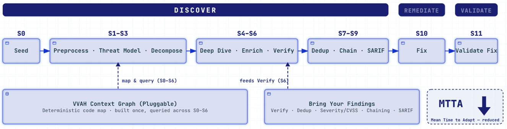

<!--
Copyright 2026 Visa, Inc.

Licensed under the Apache License, Version 2.0 (the "License");
you may not use this file except in compliance with the License.
You may obtain a copy of the License at

    http://www.apache.org/licenses/LICENSE-2.0

Unless required by applicable law or agreed to in writing, software
distributed under the License is distributed on an "AS IS" BASIS,
WITHOUT WARRANTIES OR CONDITIONS OF ANY KIND, either express or implied.
See the License for the specific language governing permissions and
limitations under the License.
-->

# Visa Vulnerability Agentic Harness (VVAH)

> An application security pipeline that discovers, verifies and fixes vulnerabilities in source code, and validates the fixes.


VVAH is Visa's open-source agentic pipeline for vulnerability discovery,
remediation and validation, built on
[learnings from Project Glasswing](https://corporate.visa.com/content/dam/VCOM/corporate/visa-perspectives/security-and-trust/documents/project-glasswing.pdf). It runs in three
phases: **Discover** (S0–S9), **Remediate** (S10) and **Validate** (S11).
Deterministic stages handle repeatable work, and agentic stages handle
judgment. A pluggable code graph is built once per scan and queried by the
analysis stages. Each model-driven role can run on Anthropic models or on any
OpenAI-compatible endpoint, including open-weight models, so no single provider
is required.



## Overview

Traditional SAST tools generate findings. VVAH closes the loop: it discovers
vulnerabilities, verifies each one adversarially against the code, proposes or
applies fixes, and has an independent review panel grade those fixes. The result
is a shorter Mean Time to Adapt (MTTA): the time from a new vulnerability class
disclosure to a validated fix moves from weeks to hours. The gain does not come
from faster scanning. It comes from automating the triage, reproduction and
verification steps that consume most of that time.

Each finding ships with its evidence: the code location, the exploit scenario
and preconditions, the adversarial verifier's rationale and, for HTTP APIs,
optional live exploit confirmation. Findings stay triage candidates, so a person
reviews each one before acting; the evidence makes that review fast.

## Quick Start

Needs Python 3.11+ on macOS arm64, Linux x86_64/aarch64 (glibc 2.34+) or
Windows amd64, and an LLM provider credential ([Models](docs/models.md)).

> **Authorized use only.** A scan sends source code to your configured model
> provider and spends model tokens. Scan only code you are authorized to test,
> through approved endpoints. See [Limitations](docs/limitations.md).

```bash
git clone https://github.com/visa/visa-vulnerability-agentic-harness
cd visa-vulnerability-agentic-harness
pip install .                                    # inside a virtual environment
cp .env.example .env                             # set your LLM provider credential
vvaharness setup                                 # readiness check; no model spend
vvaharness estimate --repo /path/to/your/repo    # scope and token preview; no model spend
vvaharness scan --repo /path/to/your/repo --stop-after s9   # detection only, no code edits
```

Using uv? Replace `pip install .` with `uv sync`, then prefix each `vvaharness`
command with `uv run`. uv creates the virtual environment for you.

Or run a scan from Python. `scan()` does not read `.env`, so export the
credential first:

```python
from vvaharness.sdk import ScanOptions, scan

result = scan(ScanOptions(repo="/path/to/your/repo", stop_after="s9"))
print(result.exit_code)
```

Need more detail? See [Install and readiness](docs/USER_GUIDE.md#install-and-readiness)
in the User Guide. Check [supported models](docs/models.md) before you begin.

## What's new in 1.5

Findings that are faster to review, model spend where it counts, and a pipeline
you can build on.

- **Verdicts you can check.** A verdict cites real callers and callees, not one
  snippet. S2, S4 and S6 query a per-scan
  [code graph](docs/architecture.md#code-graph) through read-only tools.
- **Model spend where judgment is needed.** S0, S1, S3 and S5 make no model
  call, and S8 ranks deterministically, so a failed chain analysis still ships a
  ranked report. One auto-exclusion survey before S1 calls a model;
  `--no-auto-step1` turns it off.
- **An expert's evidence bar.** 17 skills give the deep dive, and the threat
  model on `via: deepagents`, a playbook per weakness family, so a session checks
  the evidence an expert would demand before it reports a candidate. See
  [Skills and hard gates](docs/architecture.md#skills-and-hard-gates).
- **One answer for every tool.** CI gates, dashboards and reviewers read the same
  findings: Markdown, SARIF and a versioned `findings.json` render from one
  [typed report](docs/architecture.md#typed-data-contracts).
- **Your scanners, verified.** Send findings from the scanners you already run
  through VVAH verification with `inject_findings`, and run scans from Python.
  Semgrep is the reference plugin, with its own profile. See the
  [plugin SDK guide](vvaharness/sdk/README.md).
- **Safer scans of your code.** Tool confinement (S10 writes on `via: sdk`,
  reads on the `via: cli` bridge) runs on every tool call, symlinks cannot widen
  the scan scope, and redaction covers every log field and console line.

> **Upgrading from 1.4?** Use a fresh environment: 1.5.0 adds an embedded graph
> runtime, installs only on the Quick Start platforms, and does not reuse 1.4.x
> checkpoints. Full details: [CHANGELOG.md](CHANGELOG.md#150--2026-10-09).

## Pipeline

**Discover (S0–S9)**

| Group | Stages | What happens |
|---|---|---|
| Seed | S0 | Matches built-in source and sink patterns. No model call. |
| Preprocess, threat model, decompose | S1, S2, S3 | S1 builds the shared scan context and S3 turns each threat into an investigation unit, both with no model call. S2 models the threats an attacker would pursue. |
| Deep dive, enrich, verify | S4, S5, S6 | S4 investigates each unit with playbooks and graph tools. S5 checks every finding against the code on disk and adds deterministic detector findings. S6 verifies each finding adversarially and scores it with CVSS 3.1. |
| Dedup, chain, report | S7, S8, S9 | S7 merges duplicates, S8 ranks findings and links multi-step attack chains, and S9 writes Markdown, SARIF and `findings.json`. |

> **VVAH Context Graph.** A deterministic map of the code's symbols, calls,
> imports and communities, built once per scan. S2, S4 and S6 query it to see
> who calls a function, what it reaches and where sinks cluster, with no extra
> model calls; the built-in Semgrep plugin can add its own evidence to it.

> **Bring your findings.** Findings from another scanner enter the pipeline
> through the SDK's `inject_findings`. They start at S5 and get the same
> adversarial verification (S6), deduplication (S7), severity ranking and attack
> chains (S8) and SARIF output (S9) as VVAH's own findings. So VVAH also works as
> the verification and reporting layer for the scanners you already run. Semgrep
> JSON converts directly with the Semgrep plugin's `findings_from_semgrep`; see
> the [plugin SDK guide](vvaharness/sdk/README.md).

**Remediate (S10).** Applies a minimal fix for each top finding, or proposes one
without edits through `vvaharness remediate --mode report-only`. In a scan, S10
runs in fix mode and **edits the target's source**. The `sdk` and `full`
profiles turn it on, `--remediate` turns it on with any profile, and
`--stop-after s9` skips it.

**Validate (S11).** A read-only panel of three adversarial reviewer personas
grades each fix as Fixed, Partially Fixed, Not Fixed or Inconclusive. It reviews
the code and runs no tests. The `sdk` and `full` profiles turn it on.

## Features

| Feature | What you get |
|---|---|
| 📚 **17 security playbooks** | Specialist skills per weakness family. Most lenses set a hard gate that the model applies before it reports a finding. For injection: a reachable source, an exploitable sink and no effective defense. |
| 🔌 **SDK and extensions** | Run scans from Python, send other scanners' findings through verification with `inject_findings`, and add Semgrep evidence with the built-in plugin. |
| 🎯 **Exploit verification** *(beta)* | Optional live HTTP evidence that a finding is exploitable on a local API; `ev-replay` re-runs the confirming requests after you ship a fix. [Details](docs/features.md#exploit-verification-add-live-api-evidence) |
| 🔀 **Multi-model** | Each role picks its own model and route: Anthropic, or any OpenAI-compatible endpoint, including open-weight models. No single provider dependency. [Models](docs/models.md) |
| 🛡️ **Operational resilience** | Handles model refusals, unsupported reasoning settings, malformed tool calls, timeouts, resumes and retries, and redacts sensitive values. |

Covered classes: Injection · Access control · Cryptography · CSRF ·
Deserialization · Secrets · SSRF · Template handling · Sensitive-data exposure ·
[and more](docs/SKILLS.md). Full details: [Features](docs/features.md).

## Built to Keep Pace with New Threats

New vulnerability classes keep emerging. What matters is how long it takes to
start detecting them and move toward validated fixes: the Mean Time to Adapt.
VVAH keeps that time short, because a new class needs only a new playbook.

> **Example:** A new deserialization vulnerability class is disclosed. You add a
> playbook that describes how to investigate it and list its name in the S4
> skill list. The existing context graph, verification and reporting handle the
> rest. See [Adding or changing a skill](docs/SKILLS.md#adding-or-changing-a-skill).

## Documentation

| Topic | Link |
|---|---|
| Install and setup | [User Guide → Install and readiness](docs/USER_GUIDE.md#install-and-readiness) |
| User Guide | [docs/USER_GUIDE.md](docs/USER_GUIDE.md) |
| Architecture and outputs | [docs/architecture.md](docs/architecture.md) · [outputs](docs/architecture.md#out) |
| Models and backends | [docs/models.md](docs/models.md) |
| Features | [docs/features.md](docs/features.md) |
| Skills and integrations | [docs/SKILLS.md](docs/SKILLS.md) · [docs/integrations.md](docs/integrations.md) |
| Security and limitations | [docs/security.md](docs/security.md) · [docs/limitations.md](docs/limitations.md) |
| Errors and exit codes | [docs/errors.md](docs/errors.md) |

Full index: [docs/](docs/README.md) ·
[Visa Perspectives announcement](https://corporate.visa.com/en/sites/visa-perspectives/newsroom/visa-vulnerability-agentic-harness-expanded.html) ·
[Project Glasswing white paper](https://corporate.visa.com/content/dam/VCOM/corporate/visa-perspectives/security-and-trust/documents/project-glasswing.pdf)

## Contributing

See [CONTRIBUTING.md](CONTRIBUTING.md). This repository is not currently
accepting external code contributions; file bug, documentation, setup, and
feature-request reports through the GitHub issue forms. Report security
vulnerabilities privately via [SECURITY.md](SECURITY.md) — never through a
public issue.

## License

Licensed under the **Apache License, Version 2.0** — see [LICENSE](LICENSE) and
[NOTICE](NOTICE). Copyright 2026 Visa, Inc. Third-party licenses:
[THIRD_PARTY_LICENSES.md](THIRD_PARTY_LICENSES.md). Release history:
[CHANGELOG.md](CHANGELOG.md).

> **Authorized use only.** Scans send source code to configured model providers,
> and exploit verification sends live traffic to a local target. Use only
> approved endpoints and scan only code you are authorized to test. See
> [Limitations](docs/limitations.md) and
> [how the tool handles your data](SECURITY.md#how-the-tool-handles-your-data).
