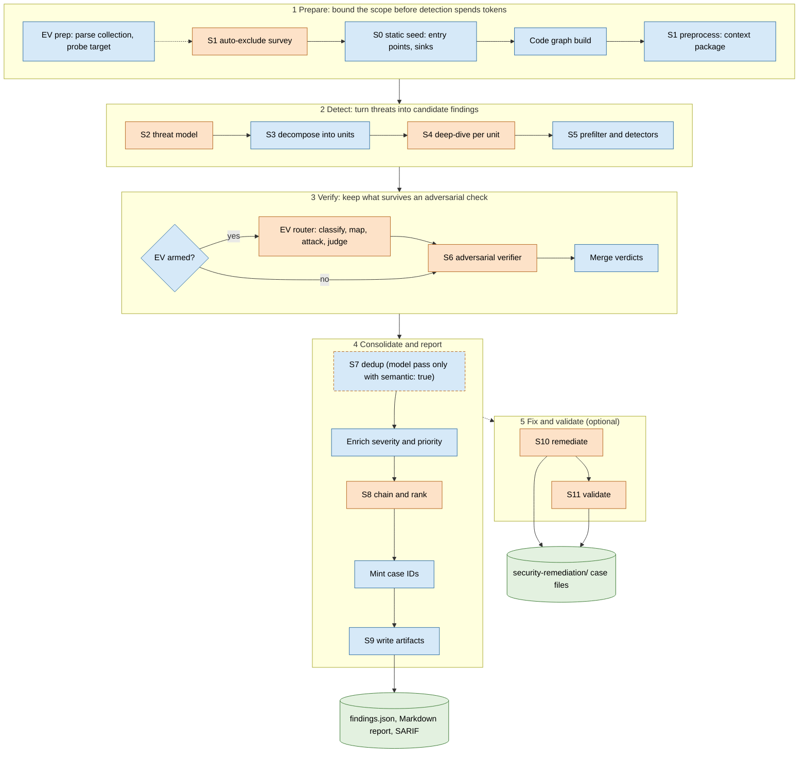

<!--
Copyright 2026 Visa, Inc.

Licensed under the Apache License, Version 2.0 (the "License");
you may not use this file except in compliance with the License.
You may obtain a copy of the License at

    http://www.apache.org/licenses/LICENSE-2.0

Unless required by applicable law or agreed to in writing, software
distributed under the License is distributed on an "AS IS" BASIS,
WITHOUT WARRANTIES OR CONDITIONS OF ANY KIND, either express or implied.
See the License for the specific language governing permissions and
limitations under the License.
-->

# vvaharness architecture

This document explains how vvaharness 1.5.0 turns a source repository into ranked security findings: a Markdown report, a SARIF 2.1.0 file and a typed `findings.json`.

- **Verified, pending your confirmation.** An adversarial verifier (S6) checks every finding against the code; confirm each one yourself before you act on it.
- **Grounded and gated.** Agents query a code graph, deterministic gates surround every model call, and one case ID joins `findings.json`, SARIF and the remediation case files.
- **Live API confirmation (Beta — API only).** Exploit verification can confirm findings against a running local HTTP API. It sends live attack traffic, so arm it only against a disposable instance ([details](#exploit-verification-beta)).

Capabilities: [features.md](features.md) · setup and running a scan: [USER_GUIDE.md](USER_GUIDE.md) · every known limit: [limitations.md](limitations.md) · security model: [security.md](security.md).

## Read by role

| You are | You want to | Start with | Then |
|---|---|---|---|
| Developer | Read and act on a report | [Markdown report](#markdown-report), [What next](#what-next) | [Exit codes](#exit-codes), [limitations.md](limitations.md) |
| Security Engineer | Judge findings, trust and egress | [Pipeline at a glance](#pipeline-at-a-glance), [Stages](#stages) | [Model roles and routes](#model-roles-and-routes), [security.md](security.md), [SECURITY.md](../SECURITY.md) |
| DevOps | Run scans and gate CI | [USER_GUIDE.md](USER_GUIDE.md), [SARIF 2.1.0 mapping](#sarif-210-mapping), [Exit codes](#exit-codes) | [Configuration model](#configuration-model), [Timeouts and retries](#timeouts-and-retries), [Run manifest](#run-manifest-run_manifest_json), [Diagnostics](#diagnostics-and-counters), [integrations.md](integrations.md) |
| Contributor | Change a stage | [How a stage runs](#how-a-stage-runs), [Stages](#stages), [Codemap](#codemap) | [Typed data contracts](#typed-data-contracts), [Skills and hard gates](#skills-and-hard-gates), [Architecture invariants](#architecture-invariants), [CONTRIBUTING.md](../CONTRIBUTING.md) |

## Key concepts

| Term | Meaning |
|---|---|
| Stage, profile, skill | A stage is one numbered step, S0–S11, with its own checkpoint and outcome. A profile is a bundled config file under `vvaharness/config/profiles/` that sets routes, budgets and which stages run. A skill is a packaged knowledge file the detection prompts can use; see [SKILLS.md](SKILLS.md). |
| Role, route (`via:`) | A role is a named model slot, for example `models.deepdive`; each stage that calls a model uses one. A route is the transport a role uses: `cli`, `sdk`, `openai` or `deepagents`. |
| Investigation unit, finding, verdict | An investigation unit (S3) is one unit of deep-dive work per threat with a validated surface file. A finding is one candidate vulnerability; its S6 verdict is `TRUE_POSITIVE` or `FALSE_POSITIVE`, plus confidence and a CVSS 3.1 vector. A candidate that leaves the funnel becomes a dropped finding with its reason. |
| Case ID | `vvaf1_` plus 32 hex characters. It is minted after S8 and joins `findings.json`, SARIF and the remediation case file. |

## <a id="stages-data-flow"></a>Pipeline at a glance

The pipeline narrows a whole repository to a short, verified, ranked list. Cheap deterministic stages bound what the expensive model stages see, and every model stage is followed by a deterministic gate.



Orange nodes call a model, blue nodes are deterministic code, a blue node with a dashed orange border calls a model only when you turn that pass on, and green cylinders are artifacts. Dashed edges are optional: EV prep runs when `EV_API_COLLECTION` is set or `--resume` continues a run that had it; S10 runs when the profile or `--remediate` enables it, and S11 only when the profile sets `step_validate.enabled: true`.

<details><summary>Text version</summary>

```text
1 Prepare   [EV prep]- - >[S1 auto-exclude survey]* -> [S0 static seed] -> [Code graph build] -> [S1 preprocess]
2 Detect    [S2 threat model]* -> [S3 decompose into units] -> [S4 deep-dive per unit]* -> [S5 prefilter and detectors]
3 Verify    <EV armed?> yes: [EV router]* -> [S6 adversarial verifier]*  no: [S6 ...]* -> [Merge verdicts]
4 Report    [S7 dedup](*) -> [Enrich] -> [S8 chain and rank]* -> [Mint case IDs] -> [S9 write artifacts] -> (artifacts)
5 Fix       - - > [S10 remediate]* -> [S11 validate]* -> (security-remediation/ case files)
Phases run in order 1 -> 2 -> 3 -> 4 -> 5.  * = model call;  (*) = optional model call, off by default;  - - > = optional;  (...) = artifact
```

</details>

| Stage | What it gives you | Model call (role) | Main output | Runs by default? |
|---|---|---|---|---|
| EV prep, auto-step1 | A spend-free check that the API collection parses and the local target answers: it sends one live request per path, with the method and example body the collection declares (a method exploit verification may not send goes as `OPTIONS`); repository-specific exclusions | EV prep: no. auto-step1: one call (`autoexclude`, else `preprocess`) | Probed collection; `step1.yaml` overlay | EV prep when `EV_API_COLLECTION` is set or a resumed run had it; auto-step1 yes in every shipped profile |
| S0, graph, S1 | A deterministic seed of entry points and sinks, a structural code graph, one shared context | No | Seed, graph workspace, context package | Yes |
| S2 | The threats worth investigating and the files they touch | Agentic session (`threatmodel`) | Threat model | Yes |
| S3 | Ranked work units | No | Investigation units | Yes |
| S4 | Candidate findings with code evidence | Agentic sessions (`deepdive`) | Findings | Yes |
| S5 | Real coordinates, evidence refs, deterministic detector rows | No | Findings, dropped records | Yes |
| S6 | Adversarial verdicts, confidence, CVSS 3.1 | Agentic sessions (`verify`; EV: `exploit_verification.*`) | Verified, dropped | Yes |
| S7 | One finding per underlying defect | No (`dedup` only with `semantic: true`; off in shipped profiles) | Canonical findings | Yes |
| S8 | Severity ranking and attack chains | One call, no tools (`chain`) | Final report | Yes |
| S9 | The three report artifacts | No | Markdown, SARIF, `findings.json` | Yes |
| S10, S11 | Proposed or applied fixes; validation verdicts on them | S10: agentic session per finding, can write (`remediate`). S11: agentic panel per case (`validate.*`) | `finding_case.json` | `sdk` and `full` profiles; S10 also with `--remediate` |

## Runtime dependencies

The code graph runs on an embedded JVM through the `arcadedb-embedded` wheel, so a platform without that wheel cannot build a graph; there is no source build. The graph extracts symbols with bundled tree-sitter grammars on Python 3.11 or newer. Every model stage calls your model endpoint over the network. The `claude` CLI is needed only for `via: cli` roles and for S11 on `via: cli`/`via: sdk`. Before any stage runs, the scan preflight probes each role the run can reach, so a detection credential fault exits `1` before spend. The target is untrusted input; see [security.md](security.md). Install, setup, readiness checks and how to run a scan: [USER_GUIDE.md](USER_GUIDE.md).

## In

### Target repository

vvaharness reads the directory you pass with `--repo` and nothing above it; a subdirectory scans only that subtree. These rules hold because every later stage shares one inventory and the target is untrusted:

- **File walk.** One deterministic walk with built-in exclusions plus `step1.exclude_dirs`, `exclude_exts` and `exclude_globs`; files over `step1.max_file_kb` are skipped. `target/` is excluded only when a build marker (Maven, Gradle, Cargo, sbt, Leiningen) sits beside it, so an application directory named `target` stays in scope.
- **Symlinks.** A symlink that resolves outside the repository is always dropped, whatever `step1.follow_symlinks` says, so a planted link cannot disclose host files.
- **Empty scope.** No file left after exclusions refuses the scan with exit `2` before S2, because a scan that analyzed nothing must not look clean.
- **Output directory.** `<repo>/security-scan/` must be a real directory inside the repository; a symlink there is refused, because it would redirect every artifact and the error log.

Flags that change which stages run: `--stop-after` takes `clone` (batch-only, keeps the clones), `ev` (parses the collection and probes the target, then stops before S0) or `s0` … `s11`; `--resume` reuses checkpoints; `--remediate` turns S10 on in fix mode for this run. Every command and flag: [USER_GUIDE.md](USER_GUIDE.md).

### Configuration model

Config is a layered YAML tree: (1) `--config PATH` wins, else `./config.yaml` in the working directory, else the packaged `default.yaml`; (2) built-in defaults fill every scalar knob the file omits, and list and dict keys default inside their stage; (3) `config.local.yaml` next to the chosen file deep-merges over it (`VVAHARNESS_NO_LOCAL_CONFIG` skips it; the startup line `config overlay: <path> applied (overrides: …)` lists what it changed); (4) `${NAME}` and `${NAME:-default}` expand over the merged tree, and a secret-named variable may expand only into the four credential keys ([security.md](security.md)). Profiles, keys and environment variables: [features.md](features.md), [models.md](models.md), [USER_GUIDE.md](USER_GUIDE.md).

- **Config inside the target.** Explicit `--config` inside `--repo` exits `2`; an auto-detected `./config.yaml` inside `--repo` warns and the packaged default applies; a `.env` inside the target is not loaded. `VVAHARNESS_ALLOW_CWD_CONFIG` overrides all three. The target is untrusted, so invoke vvaharness from outside it.
- **Overlay trust.** `config.local.yaml` is honored only when the invoking user or root owns it and it is not group- or world-writable; otherwise exit `2`. Keep it outside the target, because the overlay can change routes, endpoints and tool permissions. It resolves next to the chosen config and gets the same target check, so it can lie inside the target only when `VVAHARNESS_ALLOW_CWD_CONFIG` is set or in a `--repo-file` batch, which checks no config against a target.
- **LLM-written overlay.** The `--auto-step1` overlay is applied without `${…}` expansion, so model text never reads your environment.

> Config is not schema-validated: unknown keys are ignored so older configs stay loadable, and the cost is that a misspelled key does nothing. Check the `config:` startup line, read the overlay banner, and run `vvaharness doctor --config <file>` after every edit.

### Batch input — repos.csv

`--repo-file` scans many repositories in one invocation. Each row is cloned (or read from a local path) and scanned with fresh process-wide state. A worked example ships at `inputs/repos.example.csv`.

> The list is a trust boundary. A `Path` URL decides which host receives the configured git token, and an inline `user:token@host` is masked in logs and `batch_summary.md` but still sent. Accept a list only from a trusted operator, and restrict it to hosts you control.

| Column | Required | Aliases (case-insensitive) | Meaning |
|---|---|---|---|
| `AppId` | Yes | `application_id`, `app_id`, `applicationid` | Application identifier. Drives grouping, application-context lookup and SARIF `applicationId`. |
| `RepoName` | Yes | `repository_name`, `repo_name`, `repo` | Repository slug. Names report files and, when `Path` is blank, builds the clone URL. |
| `Path` | No | `url`, `repo_url`, `ref` | A git URL (`http://…`, `https://…`, `ssh://…`, `git@…`, or ending in `.git`) or an existing local directory. Blank means `{batch.git_base_url}/{RepoName}.git` (or `GIT_BASE_URL`). |

| Rule or mode | Behavior and why |
|---|---|
| Validation | A `.csv` file needs its header as the first row, UTF-8, BOM tolerated; other columns are ignored. Any other suffix uses the line-based `.txt` list format, which skips comment and blank lines and has no BOM tolerance. At most 64 MiB and 200,000 data rows; parsing streams under both caps. In a `.csv`, a row with only one of `AppId`/`RepoName` is an error and a row with neither is skipped; the list format rejects any empty field. A `Path` starting with `-` is rejected so `git clone` cannot read it as an option; two rows with an identical `Path` are rejected. The whole file is validated before the first clone and any error exits `2`, so a bad list never yields a partial batch. `batch.skip_repo_patterns` (case-insensitive globs on `RepoName`) drops rows before cloning. |
| Ungrouped (default), `--group-by-app` | Ungrouped runs one scan per row: cloned rows write to `<workspace>/<RepoName>/security-scan/`; local-directory rows are scanned in place, with output inside that directory, so in-scan S10 fix mode edits that directory; the scan prefixes every finding path with the repo name. `--group-by-app` runs one scan per `AppId` over a staged directory with one subdirectory per repo, written to `<workspace>/<AppId>/security-scan/`; a local directory is copied with `.git` excluded and symlinks copied as links, so the S1 symlink guard still applies. |
| Clone, isolation, failure, exit | `git clone --depth 1`, non-interactive, 600 s timeout. A clone directory is reused only when a state-directory marker proves it came from the same ref. Before each repository the batch resets token, stage and counter tallies, warn-once registries, the redaction registry and the abort flag. An ordinary error fails that row. An authentication or proxy failure inside S4 or S6 stays in that repo: S4 marks the units it did not analyze `halted`, the row is `DEGRADED`, and S6 records the affected findings as `VERIFY_ERROR`; the batch continues. An authentication, proxy or state-store error that ends a repo's scan stops the whole batch, because every remaining row would fail the same way. A batch ignores `EV_API_COLLECTION` with a warning. `<workspace>/batch_summary.md` lists every row of a batch that runs to the end. Exit `0` when all rows are OK, `1` when any row failed, `3` when rows only failed to validate their fixes. |

## Process

### How a stage runs

Every model stage has the same shape, so one set of guardrails covers all of them.

1. **Deterministic preparation.** Plain code selects and packs the input: units, batches, windows, evidence blocks.
2. **One agentic session per unit.** The session gets read-only file tools (path-jailed, except native `via: cli` tools), the stage's graph tools (S2, S4, S6) and per-session budgets for turns, model calls and tool calls. Tool permits are enforced where the tool executes; on plain `via: cli` the `claude` CLI enforces them through `--tools` and `--restricted`. Where a stage installs an evidence gate, it holds a verdict until a required graph tool ran, on every route that carries the graph tools. S2 installs it with `step2.require_graph`, S4 with `step4.planning` and `step4.evidence_gate`, and S6 with `step6_verify.require_graph`. In the shipped profiles the S2 gate is on, the S6 gate is off, and the S4 gate is on in `full`, `sdk` and `taint`. The gate relents after `require_graph_rejections` (S2, default 2) or `evidence_gate_refusals` (S4/S6, default 3) refusals so a session cannot loop forever. S2 and S4 can also require a `write_todos` plan first (`planning`, deepagents only).
3. **Structured output, then deterministic gates.** The session returns a typed object (for example the threat model or the S6 verdict list); a reply that fails the schema gets a bounded re-ask or a one-call JSON repair. Plain code then checks paths, lines, CWEs, duplicates and citations before the result moves on.

**Sub-agents.** Detection stages (S2, S4, S6) do not delegate: each unit runs in one session and no stage passes a sub-agent list. Sub-agents exist only in S10 (one `fixer`, deepagents only: it holds the only write tool) and S11 (three read-only personas, `security-architect`, `penetration-tester` and `cross-repo-analyzer`). Per-route tool surfaces and redaction: [security.md](security.md). On `via: cli`, tool confinement relies on the installed `claude` CLI supporting `--tools` and `--restricted`; use a build that supports both before you scan untrusted code.

### Typed data contracts

Typed contracts keep every artifact of a scan in agreement and catch a wrong field where it is written, not several stages later as wrong output. Every stage hands the next one a typed model from `vvaharness/models/`, not a raw dict.

| What is typed | How it is enforced | Why it matters |
|---|---|---|
| Stage hand-offs and checkpoints | Each S0–S9 checkpoint is validated against its stage's type on load (`vvaharness/orchestrator/checkpoints.py`). A stored value that fails validation is discarded with a warning, and that stage runs again. | A corrupt checkpoint, or one in an older release's shape, cannot reach a later stage. |
| The final report | S9 renders `findings.json`, the Markdown report and SARIF from one typed `FinalReport`, with no model call. `findings.json` carries `schema_version` (`"1.0"`). | The three artifacts cannot disagree, and a consumer can check the schema version before it reads. |
| Remediation input | Standalone `remediate` reads `findings.json`; in-scan S10 uses the same typed report in memory. A corrupt `findings.json` stops `remediate` instead of falling back to the Markdown report. | A fallback parse could fix a different set of findings than the scan reported. |
| Backend settings | The `cli`, `sdk` and `openai` routes keep their settings in typed records (`CliConfig`, `SdkConfig`, `OpenAiConfig` in `vvaharness/backends/llm/models.py`). | In backend code a misspelled settings key is a type-check error, not a silent no-op that later shows up as a missing CA bundle or credential. A misspelled YAML key is still ignored; see [Configuration model](#configuration-model). |

The types a plugin or an embedding caller sees, field by field: [integrations.md](integrations.md#finding-fields).

### Timeouts and retries

Clocks keep one slow call from stalling a scan, and retries keep one flaky call from losing a unit. A call that exceeds its clock raises `VVAH-E008` and counts in `llm_call_timeouts`; what each route and stage does next is in the table below and in [errors.md](errors.md#vvah-e008-call-timed-out).

| Layer | Bound | On expiry |
|---|---|---|
| Request and session clocks | `via: sdk`/`via: openai`: 900 s request fallback when the stage passes none; the stage timeout per session, checked before each turn. `via: cli`: 1800 s one-shot, 3600 s per agentic session. `via: deepagents`: only the clocks the stage configures. Effort `xhigh` scales request and session clocks by 1.1; `max` by 1.2 and 1.5. | `VVAH-E008` |
| Stage deadline (S2, S4, S6 per batch, S8) | The stage's `deadline` key (`step6_verify.batch_deadline` for S6); `0` means no clock | S2, S4 and S6 resume the live session for a final answer, else replay the transcript tool-free at low effort; S8 replays the transcript at once. A replayed verdict is marked `[replayed]`. The route clock fires about 20 s earlier; `via: cli` gets SIGINT, then SIGKILL after 20 s. |
| S6 batch ceiling; S10 session | `step6_verify.batch_wall_clock_ceiling` (900 s in every shipped profile, scaled by effort); `step_remediate.timeout` (3600 s in every shipped profile) | The batch is split or its findings are recorded as `VERIFY_ERROR`; `VVAH-E008` with no resume |

Graph queries time out after 30 s (error to the model), batch clones after 600 s (that row fails), and exploit-verification requests after `step6_exploit_verification.timeout_s` (15 s default). Retries: an authentication failure gets 3 fast retries (2, 4, 8 s), then halts with `VVAH-E001`. A proxy or TLS fault halts at once with `VVAH-E002`. A reply cut off by the output budget gets one resend at double the budget (capped at the model maximum), then fails the unit with `VVAH-E005`. A rejected structured reply gets one full re-dispatch without `effort` or a JSON-repair call; then the unit fails, or S8 ships its deterministic report. On `via: cli` a rate limit gets 4 retries (30, 60, 120, 240 s; a hard usage cap is not retried) and a pending result 3 retries (5, 15, 30 s). Each `VVAH-E00N` code and its recovery steps: [errors.md](errors.md#named-errors).

### Code graph

The code graph lets agents answer "who calls this?" and "what does this reach?" from structure, not from a guess over a snippet. It is built on every scan, after S0 and before S1, with bundled tree-sitter parsers in bounded worker processes, then deterministic Leiden community detection, stored in embedded ArcadeDB; no model call, no target code execution. The workspace lives under `$VVAHARNESS_STATE_DIR/graphs/<run_id>/<random>/`, is deleted when the scan exits, and is never checkpointed: `--resume` rebuilds it. Its own file walk, ignore files and workspace handling: [security.md](security.md); the embedding SDK and plugins: [integrations.md](integrations.md). Symbols are extracted for 17 language labels: Go, Python, JavaScript, TypeScript, TSX, Java, Kotlin, C#, Scala, C, C++, Rust, Ruby, PHP, Swift, Dart, Solidity; supporting formats get a file node only. S1 reads modules and the primary language; S2, S4 and S6 call `GraphContext`, `GraphImpact`, `GraphNeighbors`, `GraphImporters`, `GraphCommunityOf` and `GraphSinksInCommunity`. A bad argument returns an error object instead of ending the session; each call counts as `graph_tool_result_hit`, `_empty` or `_error`. A graph with no edges, or fewer nodes than `step0.min_graph_nodes_for_gate` (10), is "degenerate": graph-evidence requirements stand down with one warning per stage, and the scan continues.

> A failed code-graph build stops the scan with exit `1` before S1 and before any S2–S6 model call; only the S1 auto-exclude survey has spent tokens. Run `vvaharness doctor`, fix the platform or graph dependency it names, then re-run.

### Skills and hard gates

Skills give S4, and S2 on `via: deepagents`, a specialist playbook per weakness family, so a session checks the evidence an expert would demand before it reports. vvaharness ships 17 skills under `vvaharness/skills/`: 15 lenses, one per weakness family, and two methods, `code-exploration` (a whole-tree inventory) and `sibling-instances` (a sweep for repeats of a confirmed defect). On the first S2 or S4 session the harness copies them into `<repo>/.vvaharness/skills/`, and it deletes the copy when the scan ends. The S4 prompt names every skill and tells the model to open at most one lens.

Most lenses state a **hard gate**: the conditions a candidate must meet before it becomes a finding. The injection lens requires all three:

1. **Sink.** A call that interprets its input, such as a SQL executor, a shell, an XML parser or a template renderer.
2. **Source.** Input that an external actor can reach, including a database row an untrusted party wrote earlier.
3. **No defence.** No parameterisation, allow-list, context-correct escaper or safe library wrapper between source and sink.

A literal argument, or no path from source to sink, drops the candidate. Other lenses set the gate for their family: SSRF uses the same sink, source and no-defence shape, and CSRF requires a state-changing endpoint, a cookie or basic-auth session, and no effective CSRF defence. A hard gate is an instruction the model applies, not a code check; the deterministic gates that follow it (S5 path and line checks, the S6 confidence floor, S8 citation checks) are code. Catalog, lifecycle and how to add a skill: [SKILLS.md](SKILLS.md).

### Stages

[Pipeline at a glance](#pipeline-at-a-glance) says what each stage gives you; this table says how each stage is guarded and how it fails.

| Stage | Guardrails | Fails / limits |
|---|---|---|
| auto-step1 (S1 auto-exclude) | Reads the directory tree, extension histogram, largest files, README and manifest excerpts. Deterministic vetoes drop any proposal that erases a language or removes templates, key material, secret-bearing files or client files with DOM sinks; an overlay that would empty the scope is discarded. | The scan continues with no overlay; `--resume` re-vets a stored overlay |
| S0 static seed | A built-in pattern corpus over the one walk later stages reuse | Text patterns, so non-Python code gets a thin seed |
| S1 preprocess | Seed entries that do not resolve to an in-scope file are dropped | Empty scope: exit `2` |
| S2 threat model (one agentic session) | Reads the context package, documentation, manifests, representative configs, API artifacts and a baseline checklist for the detected repository kind. Unresolvable `surface_files` are dropped; caps keep the highest-ranked threats, then re-promote any evicted threat that is the only cover of a trust boundary. | A hollow reply on a non-empty repository gets one re-ask; still hollow stops the scan with exit `1`, no report. Any other error continues with no threat model, marked degraded (exit `1`). |
| S3 decompose | One unit per threat with a validated surface; rank = impact × likelihood; size from lines of code; no catch-all unit | — |
| S4 deep-dive (one session per unit or small batch) | Units batch by file overlap; large units run alone; a per-unit cap `step4.max_findings_per_run` (a batched session caps each member unit); same-site findings collapse | An authentication or proxy failure halts every remaining unit, marked degraded (exit `1`). `VVAH-E007` (model-call budget exhausted) and `VVAH-E008` fail one unit. |
| S5 prefilter | Path and line-bounds checks against the file on disk; header-anchored Python findings move to the dangerous statement (Python-only); same-site duplicates collapse; 11 detector rules ship and 9 are enabled | Never fatal: a bad finding becomes a drop record |
| S6 verify (one session per batch of file-sorted findings) | Wave 2 re-verifies the verifier's own discoveries in fresh sessions; `step6_verify.min_confidence` gates true positives; a replayed false positive below the gate, or a refutation whose premise contradicts the file's imports, is held `INCONCLUSIVE` | A failed batch splits into single findings once; repeated content-guardrail blocks with no success abort the stage. Verdicts are model judgments; the confirmation rate is not a precision figure. |
| S7 dedup | Merge only within one file, with compatible class or CWE, nearby original lines and overlapping titles | — |
| Enrichment | Pure arithmetic and keyword rules | VulContextSeverity needs application context; without it OffensivePriority caps at P3/P4 |
| S8 chain and rank | Ranked ids must be ones the model was shown; chains need two distinct findings; citations must resolve; severity rises only when hops are evidenced | Any call or parse failure ships the deterministic, severity-sorted report, marked degraded (exit `1`); an authentication or proxy error halts the scan. Chain counts can vary between runs. |
| Case IDs | `vvaf1_` + SHA-256 of path, line bucket (10 lines) and CWE or class; a bucket clash gets a salted id | A duplicate id after minting stops the scan before `findings.json`, the Markdown report, SARIF or any case file is written |
| S9 report | Renders `findings.json`, Markdown and SARIF from one typed final report, with no model call; redaction runs on every artifact; Markdown and SARIF derive their health status from the same report predicates; SARIF folds identical results (`step9.duplicate_result_guard`) | An error writing SARIF exits `1`; `findings.json` and the Markdown report are already on disk. The Markdown report renders before S10/S11, so their spend appears only in the run manifest. |

> **S2 sets the coverage ceiling.** S3 builds units only from `surface_files`. A file no threat names gets no deep-dive reviewer; only the S5 deterministic detectors still read it. Before you treat a quiet file as clean, read "Files named by no investigation unit" in [Pipeline Diagnostics](#pipeline-diagnostics-markdown); raise `step2.max_threats` on large repositories.

> [!WARNING]
> **Exploit verification is Beta — API only.** It sends live attack traffic, including state-changing requests, to a localhost target, and checks only findings that map to an HTTP endpoint. A stale `EV_API_COLLECTION` in `.env` arms it, and `--resume` re-arms a run that had it; unset the variable and start a fresh run to send no traffic. See [security.md](security.md).

<a id="exploit-verification-beta"></a>**Exploit verification in the S6 slot (Beta — API only).** Setting `EV_API_COLLECTION` arms it. Before S0 it parses the collection and probes each path, spend-free; in the S6 slot its router runs `models.exploit_verification.{classify,mapper,attacker,judge}` first, live-tests the findings it can map to an endpoint and stamps the `ev_*` fields. With the shipped `ev_overrides_static: false`, every finding then still goes to the static S6 verifier. A finding exploit verification confirmed but S6 rejected stays in the report, with its static verdict and reason beside the stamp; exploit verification never removes a finding. `ev_overrides_static: true` lets a high-confidence deterministic proof set the verdict itself and skip static S6. Results are `ev_*` fields, an Exploit Verification block in Markdown and replay records in the state database, never SARIF; findings that map to no HTTP endpoint stay static-only, and batches skip it. S6 also stamps two [traits](#trait-stamps-on-a-finding-channel-control_absence) in the same reply. Operation, settings and `ev-replay`: [features.md](features.md).

> Exploit verification sends live attack payloads to a loopback `EV_TARGET_URL`. Arm it only against a disposable local instance you may attack; see [security.md](security.md).

> In-scan S10 always runs **fix mode** and edits target source; the `sdk` and `full` profiles turn it on. For detection only, pass `--stop-after s9` or use a profile with `step_remediate.enabled: false`. `report-only` exists only on the standalone `remediate --mode report-only`.

**Remediate and validate — S10, S11.** S10 runs one session per top finding by CVSS, strictly sequential, and writes `security-remediation/<NN_slug>/`; posture findings are filtered out before the cap. A policy pre-gate and a post-gate over the whole working tree wrap each session; the post-gate reverts edits to `forbid_patch_paths` and `deny_paths`. In-scan S10 is skipped with `[s10] DISABLED — HEAD moved since scan` when `HEAD` moved after the report (override with `--force`). One finding's error never stops the rest; any failed finding makes S10 exit `1`. S11 runs one read-only panel session per case in state `open`, `remediated` or `failed`, or `declined` with a `not_applicable` remediation disposition, on a staged copy of the repository: three personas vote per gate, a gate needs 2 of 3 matching votes, and the host computes the score and verdict, never the model. In-scan S10 and standalone `remediate` share one engine, so a case started in one continues in the other; S11 re-runs skip cases already validated with the same setup. Policy, routes, gates and outcomes: [features.md](features.md).

### Model roles and routes

A role is the slot a stage calls ([Pipeline at a glance](#pipeline-at-a-glance) maps them); a route is how the call travels. You change a role's model or route in config without touching stage code. Routes, providers and limits: [models.md](models.md); per-route tools and shell: [security.md](security.md). Two code seams carry the model calls. `dispatch_prompt` / `dispatch_agentic` in `vvaharness/backends/llm/deepagents.py` serve auto-step1 and S2, S4, S6, S7, S8 on all four routes; exploit verification adds a thin seam over the same backends (`vvaharness/exploit_verification/_route.py`). `get_harness()` in `vvaharness/backends/harness/` serves S11 on every route (`via: openai` is remapped to deepagents) and S10 on `via: deepagents`; S10 on the other routes calls the route backend directly.

## Out

### <a id="on-disk-layout"></a>Artifact catalog

A scan writes into three places: the target's `security-scan/` and `security-remediation/` folders, the working directory, and the state directory. Only S10 fix mode edits target source. In file names, `<module>` is the repository name made filesystem-safe and `<ts>` is `YYYYMMDDTHHMMSSZ`. **One join key:** the case ID is the SARIF `partialFingerprints["vvaFindingId/v1"]` key that joins `findings.json` and `security-remediation/`. The Markdown report does not print it. Field-level detail: [Finding fields](integrations.md#finding-fields) and [Scan and handoff types](integrations.md#scan-and-handoff-types).

| Path | Written when | Format | Consumer | Retention |
|---|---|---|---|---|
| `<repo>/security-scan/findings.json`, `<module>_<ts>_report.md`, `<module>_<ts>_report.sarif` | Every scan that reaches S8; SARIF unless `--stop-after s8` | Typed final report, atomic replace; Markdown; SARIF 2.1.0; all redacted | `remediate`, tools; people, S10/S11 report copies, upload; code-scanning UIs, CI | `findings.json` replaced by the next scan; a new Markdown and SARIF file per run |
| `<repo>/security-scan/<module>_<ts>_errors.jsonl`; `_s8_raw.txt` (and `_s8_raw_repaired.txt`) | When a non-fatal error was logged; when S8 called the model | JSON lines, mode `0600`; raw chain reply, redacted | Operators, manifest `errors_by_stage`; debugging a chain reply | Per run |
| `<repo>/security-remediation/<NN_slug>/finding_case.json`, `evidence/`, `*_report.{md,sarif}`, `validation/` | When S10 or S11 ran (**S10 fix mode also edits source files**); `validation/` during validation | Case file; `triage.json`, `summary.md`, `diff.patch`; report copies with remediation and validation blocks; staged workspace, `validation_report.json`, `synthesized_gates.json` | S11, reviewers, manifest, people, CI | Case files kept, attempts accumulate; report copies updated; `validation/` deleted after each case |
| `<repo>/.vvaharness/skills/` | When a stage loads skills (`skills: true`) | Copies of packaged skills | S2, S4 sessions | Deleted when the scan returns |
| `./run_manifest_<ts>[_NN].json` | Every `scan` invocation that returns an exit code (not `doctor`, `estimate`, `gc`, the standalone `remediate`, `validate` and `ev-replay` commands, or usage and config errors) | JSON | CI, audits | A new file per run |
| `<repo>/security-scan/<module>_<ts>_ev-replay.md` and `.json`; `<workspace>/batch_summary.md` | Only on `ev-replay`; batch mode | Markdown (plus JSON for replay) | Operators | Per run; per batch |
| `$VVAHARNESS_STATE_DIR/vvaharness.db`, `graphs/<run_id>/<random>/` | Every scan; keep `VVAHARNESS_STATE_DIR` outside the target, because it holds checkpoints a repository must not read or plant (`--resume` refuses a state directory inside the target) | SQLite (mode `0600` in a `0700` directory on POSIX hosts); ArcadeDB workspace | `--resume`, `ev-replay`, `gc`; S1, S2, S4, S6 | Until `gc`; graph deleted at scan exit |
| Upload to `output.ingest_url` | Only with URL and token set | Multipart POST of Markdown and SARIF | Your ingest service | Once per run |

<a id="cmdb-enrichment"></a>**Application inventory enrichment.** Set `inject.cmdb_file` to a local application-inventory CSV (columns `id`, `name`, `externally_facing`, `pci`, `pan`, `pii`, `parent_id`) and pass `--application-id`. The scan then adds VulContextSeverity (CVSS 3.1 environmental scoring) and full-range OffensivePriority to each finding, and SARIF run properties carry `applicationName` and `cmdbSource`. A relative path resolves against the config file's directory. Without the file, base CVSS and OffensivePriority still compute, OffensivePriority caps at P3/P4, and the report says so.

### Markdown report

The Markdown report is the human view of one run. It renders deterministically from the typed report; models wrote only the field values. It always has `## Summary` (from S8), `## Scan Metrics` (scope, coverage, tokens, Pipeline Diagnostics), `## Verification` (the funnel), `## Findings (N)`, `## Dropped Findings` (each tagged `FP`, `UNCONFIRMED`, `VERIFY-ERR`, `EXCLUDED`, `GUARDRAIL`, `INCONCLUSIVE` or `DUP`) and a scan-scope appendix. `## Threat Model` (with `### Ranked threats` and an `Investigation unit` column) appears when S2 produced a model, `## Posture Findings (N)` when posture findings exist, `## Exploit Chains` when the chain pass ran, and the files-named-by-no-unit appendix only with `output.emit_unreachable_appendix`. `## Scan Health` appears only when a run lost coverage: failed or timed-out units, a chain pass that could not run, a hollow scan, a coverage-degraded reason, an evidence gate that relented, an unranked finding, skipped deep-dive work (`deepdive_skipped`), or any logged non-fatal error. Finding no chains is a normal outcome, not degradation.

**Finding block.** Each finding renders as a fixed block that opens `### N. [SEVERITY] Title`, then one line each for `**Class:**`, `**CWE:**`, `**File:**`, `**CVSS 3.1:**`, `**VulContextSeverity:**` (with application context), `**OffensivePriority:**` and `**Also at:**` (when S7 collapsed other sites), then Description, Impact, Exploit scenario, Preconditions, a code snippet, How to fix, `**Exploitability:**` and Adversarial verification. When exploit verification ran, the block ends with `**Exploit Verification:** <VERDICT> (beta)`; `SAST-ONLY` means not live-tested, never safe.

#### Trait stamps on a finding (`channel`, `control_absence`)

The S6 verifier fills two traits in the reply it already returns; no extra model call runs, and neither trait changes a verdict, a confidence or a CVSS score. `channel` is `main` (default) or `posture`: a posture finding is about how the artifact is built or deployed (container, CI, dependency hygiene), not application code; it renders in the posture section and S10 skips it. `control_absence` (`false` by default) marks a finding that describes a missing control rather than something an attacker carries forward; S8 treats such a step in the middle of a chain as a quality problem. An unknown value falls back to the default; `step6_verify.trait_stamps: false` turns stamping off.

#### The `## Verification` block

The block reconciles the raw candidate count with the reported count, so you can see where candidates went without reading logs.

| Line | Reads |
|---|---|
| `Raw findings (pre-verification)` | `raw_findings_count`: S4 survivors plus S5 detector rows, taken after S5 and before S6 |
| `Verified true positives: A → B reported after dedup`, `of which D verifier-discovered and C repeat-site clone(s)` | `A` = S6 `TRUE_POSITIVE` verdicts before S7; `B` = reported findings after S7; findings minted during S6 are not in the raw count (omitted at zero) |
| `False positives`, `Unconfirmed`, `Verifier errors or inconclusive`, `Verifier-discovered findings dropped on re-verify`, `Duplicates collapsed (all passes): N — P before verification, Q after` | Drop counts by reason, with undetermined outcomes kept apart from false positives; non-duplicate drops whose `chunk_id` ends in `+s6` (shown only when non-zero); S5 and S7 collapses |
| `Verifier confirmation rate` | `TRUE_POSITIVE / (TRUE_POSITIVE + FALSE_POSITIVE)` over the verifier's own verdicts; not a precision figure |
| `Exploit verification: …` and `Kept without a true-positive verdict` | Exploit-verification roll-up and rescued rows; only when they apply |

"Dropped", not "refuted": the re-verify bucket holds FALSE_POSITIVE, UNCONFIRMED, VERIFY_ERROR, GUARDRAIL_BLOCKED and INCONCLUSIVE outcomes alike. An S7 `DUPLICATE` row copies the `chunk_id` of the discovery it collapsed and is not counted there. A fresh run also checks the finding ledger: every finding that entered S6 must land in exactly one of verified or dropped, after verifier discoveries and repeat clones are subtracted; an imbalance is logged as `LEDGER_IMBALANCE` and recorded as a recovered error, and no artifact field changes.

#### Posture findings render in a second section, never filtered out

With `output.posture_channel` on (the default in every shipped profile), findings stamped `channel: "posture"` render under `## Posture Findings (N)` after the main list; `false` renders one interleaved list. A posture finding keeps its severity, CVSS and full block, and stays in `findings.json` and SARIF (`properties.channel`). Both S10 entry points skip it before the top-N cap (in-scan S10 from the report in memory, `remediate` from `findings.json`), because its fix is a Dockerfile, lockfile or CI change. `### N.` numbers are global, so the main list has gaps and chain references (`#N`) keep resolving. The Verification line states the split, for example `→ 9 reported after dedup (8 application-defect + 1 posture)`.

#### Exploit Chains

Chains are the one report part a model composes, so deterministic gates check every chain before it renders. A chain block shows `### Chain N — [SEVERITY] Title`, a `**Path:**` of `#N` finding references, optional `**Reached via:**`, `**Requires:**` and `**Blocked by:**` lines, `**Step links:**` with a cited `file:line` per hop, and a `_Link coverage_` line when there is something to say. Chains never appear in SARIF.

| Rule | Behavior | Why |
|---|---|---|
| Distinct steps, duplicates, unreadable entries | A chain whose steps resolve to fewer than two distinct findings is dropped (`chains_dropped`); two hops at one `file:line` count as one. A chain with a step list identical to a kept chain is collapsed (`chains_deduped`). An entry missing a required field is dropped at parse time (`chains_invalid`); the rest of the reply ships. | One code fact cannot be its own precondition; one bad entry must not cost the whole pass. |
| Link evidence, unpromoted links | Each claimed hop link must cite a `file:line` that resolves in the repository (`link_coverage` `"N/M"`); unconfirmed links stay, with a note. A `feeds` claim that no shipped chain carries in order is disclosed (`unpromoted_links`, `s8_chain_link_unpromoted`), never promoted. | The reader checks the path instead of trusting prose; a marked link is not evidence. |
| Severity gate | Severity rises to the strongest hop only when hops are evidenced, no middle step is a missing control, and the narrative does not hedge. Otherwise the lift is withheld (`severity_decision: "lift_withheld"`) or a self-awarded rating is capped (`"self_raise_capped"`). The gate never lowers a rating below the strongest hop; a withheld lift leaves the model's lower rating in place. | Stops every chain from shipping as `[CRITICAL]`. |
| Lower-confidence regroup, prose escaping | A chain with two or more entries in `quality_notes` renders under `### Lower-confidence chains`, with its number kept. Angle brackets in chain prose are escaped in Markdown only; `findings.json` keeps raw bytes, and its `steps` are zero-based indices (the Markdown `#N` is index + 1). | Regrouping is a rendering choice, so nothing is dropped; a payload like `<script>` must print, not vanish. |

#### The `hollow` signal — exit 0 and nothing found

A clean target and a broken threat model can both end with exit `0` and no findings. The hollow signal separates them. A run is hollow when files were in scope, S2 degraded even after its retry, and no finding existed before or after verification. The report then opens Scan Health with `⚠️ **Hollow scan**`. Treat it as "re-run before you believe the empty result". It is not a failure: the exit code and SARIF `executionSuccessful` stay unchanged, and SARIF carries `runs[].properties.hollow`. A second signal, `coverage_degraded`, asks whether files or findings went without a genuine look. Either signal can be true without the other. SARIF carries its reasons as `coverageDegraded` and `coverageDegradedReasons`. Nothing gates on either signal; CI jobs can.

| Code | Bullet | Fires when |
|---|---|---|
| `s6_undetermined` | `Verification coverage loss — N of M verdicts were undetermined (P%)` | The verifier left findings without a verdict (`VERIFY_ERROR`, `GUARDRAIL_BLOCKED`, or `INCONCLUSIVE` drops; `INCONCLUSIVE` is a distinct reason, not a false positive or verifier error); they are neither confirmed nor cleared. |
| `zero_analysis` | `No file reached deep-dive analysis` | Files were in scope but none was analyzed, so every finding comes from a deterministic detector. |
| `llm_turn_cap_exhausted` | `Turn budget exhausted` | An agentic session hit its turn budget and answered from partial evidence. |

### SARIF 2.1.0 mapping

S9 builds SARIF directly from the typed report, so `findings.json` and SARIF cannot disagree. One run, `tool.driver.name` `"Agentic SAST"`, one `rules[]` entry per `ruleId`, and a CWE taxonomy that each result's `taxa[]` resolves against.

| Result field | Meaning |
|---|---|
| `ruleId`, `level`, `rank` | The `**Class:**` label (`CWE-NNN: <name>`, bare `CWE-NNN`, or the vuln class); `error` for critical and high, `warning` for medium, `note` otherwise; CVSS base score × 10 (SARIF's 0–100 scale), recomputed from the vector, and omitted without a valid vector |
| `message.text`, `locations`, `codeFlows`, `relatedLocations`, `properties.severity`, `security-severity`, `cweId`, `cvssVector`, `description` | Title plus `[CVSS score: vector]` when a vector exists; file and start line; source-to-sink flow; collapsed duplicate sites; Final severity; CVSS base score as a string for code-scanning UIs, or 9.0/7.0/4.0/0.1 by severity without a valid vector; the narrative, at most 4000 characters |
| `properties.channel`, `properties.origin` | `main` or `posture` (omitted when `output.posture_channel: false`); `detector` or `s6_discovered` (absent for investigation findings) |
| `partialFingerprints["vvaFindingId/v1"]` | The case ID; the only stable join to `findings.json` and remediation cases |

Run-level `properties` always carry `applicationId`, `enrichmentUnavailable`, `hollow`, `coverageDegraded`, `coverageDegradedReasons`, `deepdiveSkipped`, `threatsTotal`, `threatsWithoutUnit`, `threatsBeforeCap`, `threatsTruncated` and `threatsPromoted`, so a consumer can treat an absent key as unknown, not as a healthy `false`. `invocations[0].executionSuccessful` is `true` in a scan's SARIF, because an empty scope exits `2` before any artifact is written. Non-fatal errors, failed units and degradation add `toolExecutionNotifications`, and `hollow` and `coverageDegraded` tell you whether to trust an empty result. When S10 or S11 runs, it adds `properties.remediation` and `properties.validation` (plus `remediationAliases`/`validationAliases`) to each result in the copied report, under `properties` because SARIF 2.1.0 forbids extra keys on a result. Exploit-verification results are not in SARIF: read them from the Markdown report or the `ev_*` fields in `findings.json`.

#### Duplicate-result suppression (`step9.duplicate_result_guard`)

SARIF emission folds identical results that the Markdown report and `findings.json` keep, so SARIF can have fewer results than there are findings. Results identical on file, start line, effective CWE or class, message, channel and origin emit once; the survivor is the strongest severity, then report order. A duplicate-site `relatedLocation` that restates the result's own location, repeats one already emitted, or collides with any finding's primary location is skipped. A folded twin's case ID moves to the survivor's `properties.aliasFindingIds`: resolve a case ID against both the fingerprint and that list, because the fingerprint alone silently finds no row for a suppressed twin. `step9.duplicate_result_guard: false` emits one result per finding.

### Run manifest (`run_manifest_*.json`)

The run manifest is the audit record of one invocation and the only artifact that sees in-scan S10 and S11 spend. It lands in the working directory, not under `security-scan/`; a same-second name collision adds `_NN`. Read these token identities before you compare numbers. `prompt_tokens` counts fresh input, including cache writes, and excludes cache reads; `total_tokens` is `prompt_tokens + completion_tokens`; input the model saw is `prompt_tokens + cache_read_tokens`. `cost_usd` is `null`, not `0`, when no pricing table (`VVAHARNESS_PRICING_FILE` or `pricing.file`) covers the model. `cache_unparsed_calls` exists only under `totals`; non-zero means cache accounting arrived under names no backend parses. In batch mode one manifest covers the invocation. `counters` and `remediation` sum every repository; `stages`, `totals`, `pricing_status` and `errors_by_stage` hold the last repository scanned. Read each repository's tokens from `## Scan Metrics` in its Markdown report.

| Field | Meaning |
|---|---|
| `tool`, `version`, `argv`, `config_profile`, `config_sha256`, `config_local_sha256`, `target_git_sha` | The command line with secret-shaped values scrubbed; the profile and hashes of it and the overlay (`null` when absent); the target `HEAD` |
| `models` | Per role: `id`, `via`, `provider`, `declared_via`, `resolved_route`, `resolved_transport`, `effective_effort`, `use_responses_api` |
| `exit_code`, `exit_cause`, `remediation` | The process exit code; `SIGINT` or `SIGTERM` when a signal ended the run; case counts by state and decision, **omitted when S11 did not run** (absent means unknown, not clean) |
| `stages.<id>.outcome`, `totals`, `pricing_status` | `completed`, `completed_with_errors`, `error`, `not_run`, `cached`, `skipped` or `disabled` (there is no `failed` value); run-wide tokens and cost, where stage rows plus `unattributed` equal the totals; whether a pricing table applied |
| `counters`, `errors_by_stage`, `effective_scan_controls`, `ev_api_collection_sha256` | Every pipeline counter; non-fatal error counts per stage; the non-secret configuration that changes scan output; the hash of the exploit-verification collection |

### <a id="pipeline-diagnostics-markdown"></a>Diagnostics and counters

#### Diagnostic records: levels, the console line, and the `--log-file` tee

Diagnostics tell you what the pipeline did to its own inputs: decisions that change results but leave no trace in the findings. Every stage emits structured records. `--log-level` (or `VVAHARNESS_LOG_LEVEL`, default `warning`) sets the lowest level recorded. Each record renders as one line, for example `HH:MM:SS.mmm WARN  v.p.stages.s4 : <sentence>  k=v (CODE)`: a UTC clock, the level, an abbreviated module path, a fixed sentence, every field as `k=v`, and a stable `(CODE)` you can grep for. Without `--log-file`, stderr shows every record at that level and above. With `--log-file PATH` (or `VVAHARNESS_LOG_FILE`), the file gets those records as one JSON object per line, and stderr shows only `WARNING` and above, so a warning stays visible even when nobody reads the file. Level `error` or `critical` hides warnings in both places; keep `warning` or lower when you need them. Progress and operator lines (`✓`, `⚠`, `✗`) are not diagnostics: they always go to stderr, redacted, and ignore `--log-level`. `import vvaharness` as a library configures no logging. `scan_progress.style: llm_debug` prints prompts, including target source, to stderr; no shipped profile turns it on ([security.md](security.md)).

**The stage marker.** A stage line ends `✓` when it finished with no unrecovered error, `⚠` when it finished but logged an unrecovered error (`completed_with_errors`), and `✗` when it failed. A record marked `recovered: true` never turns a stage `⚠`. **The error log.** Each `*_errors.jsonl` record carries `ts`, `stage` (for example `s2`, `s6-verify`, `s10.preflight`, `scan`), `unit`, `error` (`<Type>: <message>`), `error_code` (`VVAH-E00N` when present), `category` (for model refusals), `stderr`, `recovered` and `traceback` (last 4000 characters); every text field is redacted. Before a scan configures the per-run file, records go to `./pipeline-errors.jsonl`. **Pipeline Diagnostics.** `### Pipeline Diagnostics` inside `## Scan Metrics` prints one line per counter that has something to say. A zero counter cannot tell "never ran" from "ran clean", so lines appear only when non-zero, and the subsection is omitted when all are zero. Every counter appears in the run manifest's `counters`; `findings.json` `metrics` carries the report-metric subset.

<details><summary>Pipeline Diagnostics lines and counters</summary>

| Line or counter | Meaning | What to do |
|---|---|---|
| `Threat model: **degraded**` (`s2_degraded`), `Threats truncated by the prompt cap` (`s2_threats_truncated`), `s2_threats_promoted`, `Threat-model surface paths dropped (no such in-scope file)` (`s2_surface_files_dropped`), `Files named by no investigation unit: N of M` (`s3_unreachable_files`), `Threats with no investigation unit minted` (`s3_threats_without_unit`) | S2 failed or returned no usable threats; `step2.max_threats` cut threats and some came back to keep a boundary covered; S2 named files that do not exist in scope; in-scope files no unit names; ranked threats no unit covered | Re-run on a degraded S2; raise the cap if coverage matters; a large drop count means invented paths. Unnamed files are expected on most whole-repository scans; do not read a missing finding as an all-clear |
| `Deep-dive findings discarded by the per-call cap` (`s4_findings_truncated`), `deepagents_oversize_prompts` (`VVAH-E004`), `LLM replies cut off by the output-token budget` (`llm_truncated_replies`, `VVAH-E005`), `llm_truncated_retry_attempted` / `_recovered`, `llm_call_timeouts`, `llm_call_budget_near` | A unit produced more than `step4.max_findings_per_run` findings; a prompt exceeded the route ceiling and the unit failed; a reply hit its output cap after the doubled retry; calls that timed out (`VVAH-E008`); `xhigh`/`max` calls that used 75 % of their budget | Raise the cap; lower `effort` or pack less; tune deadlines |
| `llm_adapter_evidence_gate_unenforced`, `cli_mcp_evidence_gate_unenforced`, `s4_evidence_gate_rejected_relented` (and the `s2`/`s6` pairs), `evidence_gate_stood_down_degenerate_graph` | A `via: sdk`/`via: openai` session, or the `via: cli` MCP-bridged loop, shipped a verdict without a required fact-tool call after the gate relented; an evidence gate let a verdict through after its refusals; the graph was too small, so graph-evidence requirements stood down | Raise `evidence_gate_refusals` or `require_graph_rejections`; review that unit; check the graph build |
| `s6_confirmed_without_vector`, `s6_cvss_zero_impact_on_tp`, `s6_confidence_clamped`, `s6_confidence_uniform` | True positives with no CVSS vector, or a zero-impact vector withheld; verifier confidences off the 0–10 scale were rewritten; every judged verdict carried one confidence, so `min_confidence` admitted or dropped them together | Vectors: expected, severity falls back to the detection label. Confidence: a count near the verdict count means the scores carry no ranking information; read the verdict reasons |
| `Primary model calls re-dispatched`: `s2_structured_retry_attempted`, `s4_structured_retry_attempted` (and the `s6`/`s7`/`s8` pairs), `s4_truncated_retry_attempted`, `ev_classify_truncated_retry_attempted` (and the other `*_truncated_retry_*` pairs), `s2_empty_retry_attempted`, `llm_structured_retry_truncated` | A whole primary call ran again after a rejected or clipped reply, or a hollow S2 reply | Each is a second full call; reduce what the call packs |
| `Replies re-asked for their structured shape`: `s2_parse_repair_attempted`, `s4_outcome_repaired_attempt`, `s4_batch_repaired_attempt`, `s6_outcome_repaired_attempt`, `llm_structured_prose_reask`, `llm_structured_submit_rejected` | A cheaper re-ask: a JSON-repair call, a prose re-ask, or a rejected submit handed back | Informational |
| `llm_model_refusals`, `llm_refusal_retry_attempted`, `s6_replayed_fp_held`, `s6_replayed_tp_shipped`, `s6_fp_premise_contradicted`; `s8_sparse_ranking_recovered`, `s8_chain_link_unpromoted`, `s9_sarif_dup_result_suppressed`, `openai_responses_api_calls`, `openai_responses_fallback`, `llm_effort_tier_stepped_down` | Provider refusals and their one resend (Anthropic routes only); replayed or self-contradicting verdicts held `INCONCLUSIVE` or marked `[replayed]`; S8 ranked only the findings that change a chain; disclosed links no chain carries; SARIF results folded by the duplicate guard; transport and effort learning on OpenAI-compatible routes | Set `refusal_retries: 0` if resends never recover; review those findings by hand. Informational; enumerate `findings.json` for completeness |
| `s6_outcome_members_resubmitted`, `s4_batch_member_resubmitted`, `s4_units_halted`; `graph_tool_result_hit`, `_empty`, `_error`; `s4_graph_tool_budget_exhausted` (and the other `*_budget_exhausted` counters) | Batch members re-run alone after a partial reply; units stopped by an authentication or proxy failure; outcome of each graph tool call; a session spent its tool budget | For halts, fix the credential or proxy, then re-run the scan. Mostly `_error` means the model names symbols the graph cannot find; raise the named budget |

</details>

### Exit codes

The exit code is the one-line verdict a CI gate branches on. The run manifest records it too. Named errors `VVAH-E001`–`VVAH-E008` and their recovery steps are in [errors.md](errors.md#named-errors).

| Code | Meaning |
|---|---|
| `0` | The run completed and nothing failed. Also returned when `--resume` is refused because the checkpoint directory resolves inside the target. |
| `1` | The pipeline failed: a stage error, an authentication or proxy halt, a failed graph build, a degraded report, or a failed S10 finding. Also a blocking `doctor`/`setup` failure and `estimate` on a non-directory. For `ev-replay`, a completed replay with at least one finding still vulnerable, or an unhandled error. |
| `2` | Refused: bad arguments, a missing input, a config or trust-policy conflict, an untrusted overlay, a symlinked state directory, an empty scope, or an exploit-verification gate failure. For `ev-replay`, a missing or non-loopback `EV_TARGET_URL` or `EV_OOB_URL`. |
| `3` | The run completed, but nothing it remediated validated as fixed and at least one case failed validation. A run of only inconclusive cases exits `0`. |
| `130` | Interrupted (SIGINT, Ctrl-C). |
| `143` | Terminated (SIGTERM). |

`1` means the harness broke; `3` means the fixes did not pass validation. On `3`, also read `## Scan Health` for the detection result. Treat them differently. `2` is a refusal, not a promise that nothing was spent: a batch row or an exploit-verification gate can refuse after earlier work ran. In-scan S11 runs its own preflight; a validation config it refuses disables S11 with `[s11] DISABLED — …` and the scan exits on the detection and S10 result. Non-fatal stage errors do not change the code; read Scan Health and `*_errors.jsonl` for them. In batch mode a refusal that a single-repository scan reports as exit `2`, such as an empty scope, counts as a failed row, so the batch exits `1`; see [errors.md](errors.md#batch-exit-codes).

## What next

Each output enables a next step: triage `*_report.md` by hand; load `*_report.sarif` into a code-scanning UI or a CI gate; feed `findings.json` to `remediate` or other tools; track one finding through fixes in `finding_case.json`; audit cost and models in `run_manifest_*.json`; re-check a live-confirmed exploit after a fix with `ev-replay`. For an empty or degraded result, read [Scan Health and the hollow signal](#the-hollow-signal--exit-0-and-nothing-found) and [Diagnostics](#diagnostics-and-counters); credential, proxy and config faults are in [errors.md](errors.md).

### Re-run, resume and clean up

`--resume` saves money after an interruption by skipping stages whose checkpoints are still valid. From S2 on, a stage that runs fresh makes every later stage through S8 run fresh too (S2 → S3–S8, S3 → S4–S8, S4 → S5–S8, S5 → S6–S8, S6 → S7–S8, S7 → S8); a failed S2 attempt counts as fresh. S0 and S1 each reload their own checkpoint. When an S7 checkpoint is valid, S5 and S6 checkpoints are not consulted. S4 checkpoints as one block when the stage returns, so an interruption mid-S4 re-runs all of S4. Each run writes a new timestamped Markdown and SARIF pair, also with `--resume`, while `findings.json` is replaced; bind tools to an explicit file, not the newest one. `run_id` derives from the resolved path, so moving a clone starts a new run; run one scan per checkout at a time.

> [!WARNING]
> `--resume` compares only the git `HEAD` commit: uncommitted edits and changes in a non-git target are not detected. Re-run without `--resume` after you edit the source, and resume only from checkpoints you produced.

A scan without `--resume` clears the run's checkpoints first; exploit-verification replay records survive so `ev-replay` still works after a fix and rescan. A rescan keeps these bundles unless exploit verification runs again, which replaces them with that run's set. `vvaharness gc` prunes old runs with their graph workspaces and never touches `security-scan/` or `security-remediation/`; options: [USER_GUIDE.md](USER_GUIDE.md).

### Architecture invariants

Each invariant holds in every release; a change that breaks one is a design change, not a fix.

- **Invariant:** Deterministic gates wrap every model call. *Why:* a model reply must never invent a file, line, chain or severity that code cannot check.
- **Invariant:** A finding reaches the report only through an S6 verdict or a live exploit-verification confirmation. *Why:* generative stages favor recall; S6 is the precision gate.
- **Invariant:** S9 makes no model call. *Why:* `findings.json`, Markdown and SARIF must render the same data and replay identically.
- **Invariant:** With the shipped `ev_overrides_static: false`, exploit verification adds `ev_*` fields and never rewrites a static verdict; a finding it confirmed live stays in the report even when S6 rejected it, with the static verdict shown. *Why:* a failed live test is not proof of safety, and a live proof outranks a model's refutation.
- **Invariant:** A duplicate case ID stops the scan before `findings.json`, the Markdown report, SARIF or any case file is written. *Why:* the ID keys the case file, its validation workspace and the SARIF join; a clash would give one finding another's fix or verdict.
- **Invariant:** A tool call is refused unless its session permits it, whatever the model advertises or forges. The harness enforces this on `deepagents`, `sdk`, `openai` and the `via: cli` MCP bridge; on plain `via: cli` the `claude` CLI enforces it through `--tools` and `--restricted`. *Why:* a forged or hallucinated tool call must still be refused.
- **Invariant:** A secret-named environment variable expands only into the four credential keys. *Why:* a secret must never reach a URL or log.
- **Invariant:** Before each repository, batch mode resets every process-wide registry that holds per-repository state: token, stage and counter tallies, warn-once registries, the redaction registry and the abort flag. *Why:* one repository's secrets, warnings or abort state must not leak into the next. A new registry of per-repository state must join that reset.

### Codemap

| Package | Responsibility | Start reading at |
|---|---|---|
| `vvaharness/cli/`, `vvaharness/orchestrator/`, `vvaharness/pipeline/stages/` | Command dispatch, `setup`, `doctor`, `gc`, `estimate`; scan driver, batch, checkpoints, case IDs, state store; S0–S11 stage implementations, deadline and replay helpers | `vvaharness/orchestrator/scan.py`, `vvaharness/pipeline/stages/replay.py` |
| `vvaharness/codegraph/`, `vendor/context_graph_sdk/`, `vvaharness/backends/` | Graph build, queries and tools, the bundled graph SDK; route transports, retries, clocks, the dispatch seam and the S10/S11 harness | `vvaharness/codegraph/build.py`, `vvaharness/backends/llm/deepagents.py` |
| `vvaharness/models/`, `vvaharness/config/` | Typed data contracts; loader, overlay, profiles | `vvaharness/models/scan/findings.py` |
| `vvaharness/scope/`, `detect/`, `lang/`, `evidence/`, `rules/`, `skills/`, `report/`, `exploit_verification/` | File walk, deterministic patterns, language detection, S2 evidence, CWE knowledge, packaged skills; redaction, CVSS, CWE names, application context; Beta live verification and `ev-replay` | `vvaharness/scope/walk.py`, `vvaharness/report/redact.py`, `vvaharness/exploit_verification/verify/router.py` |
| `vvaharness/remediation_agent/`, `vvaharness/validation/`, `vvaharness/sdk/`, `vvaharness/plugins/`, `vvaharness/util/` | S10 engine, policy gate, case writer; S11 panel, consensus, scoring; Python embedding API and plugins (Semgrep); logging, console, counters, error log | `vvaharness/remediation_agent/runner.py`, `vvaharness/util/errlog.py` |

### Further reading

Setup, running a scan and configuration: [USER_GUIDE.md](USER_GUIDE.md). Named errors and exit codes: [errors.md](errors.md). Capabilities: [features.md](features.md). Roles, routes and providers: [models.md](models.md). Data types, the embedding SDK and plugins: [integrations.md](integrations.md). Security model and reporting: [security.md](security.md), [SECURITY.md](../SECURITY.md). Packaged skills: [SKILLS.md](SKILLS.md). Every known limit: [limitations.md](limitations.md). Project overview and operating rules for AI coding agents: [README.md](../README.md), [AGENTS.md](../AGENTS.md).
